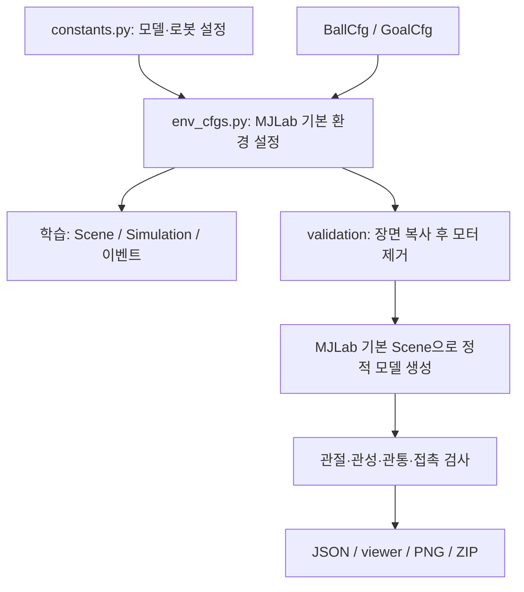

# 구현 1단계: K1 모델과 골키퍼 시뮬레이션 장면

작성일: 2026-10-30. 대상 폴더: `Goalkeeper_mjlab`.

> 문서의 단계 번호는 구현·분석 이력이다. 코드의 Stage 장면은 제거했다. 기본 실행은 모터 검사이며 아래 형상 검사 명령은 `--mode geometry`를 쓴다. 최신 구조는 [구현2단계.md](구현2단계.md)를 참고한다.

이 문서의 실행 명령은 `Goalkeeper_mjlab` 폴더 안에서 Python 환경을 활성화한 뒤 실행한다. 다른 프로젝트 폴더는 필요 없다.

공·골대 주석과 wirlwind 참조 코드 대조 결과 보완: 2026-10-31.

## 1. 이번 단계에서 사용할 수 있는 것

K1 로봇, 공, 골대, 평면 바닥을 하나의 MuJoCo 장면으로 조립하고 검사할 수 있다.
같은 모델 생성 함수를 MJLab `SceneCfg`에도 연결했다. 중요한 좌표 처리·충돌·관성·초기화 코드에는 한국어 주석을 달았다.
`main.py`를 실행하면 **MuJoCo 창이 기본으로 열린다**. 화면 없이 검사할 때만 `--headless`를 지정한다.

처음 정한 “URDF 세팅”은 실제 저장소에 이미 있는 **serial-ankle K1 MJCF(XML)를 재사용하는 방식**으로 구현했다.
URDF를 새로 만들거나 다시 변환하지 않았다. 기존 관절축, joint range, 링크 관성, 메시 배치를 유지하기 위해서다.

| 전체 단계 | 내용 | 현재 상태 |
| --- | --- | --- |
| 1 | 로봇 모델, 공·골대·바닥, 좌표계, 충돌, 초기 배치, 모델 검사 | 이번 구현 |
| 2 | 모터, PD, 토크·속도 제한, 물리/제어 주기 | 구현 완료. 구현2단계.md 참고 |
| 3 | 공 슈팅, 에피소드 reset, 난이도 | 후속 구현 |
| 4 | 관측과 action, 공 정보 표현 | 후속 구현 |
| 5 | 보상, 종료 조건, PPO 연결 | 후속 구현 |
| 6 | 본 학습, 평가, 실물 vision 연결 | 후속 구현 |

형상 검사 모드(`--mode geometry`)는 `nu=0`이다. 모터가 없는 수동 로봇이므로 물리를 진행하면 넘어질 수 있다.
형상 검사 viewer는 처음에 정지해 있고, `P`를 누를 때만 수동 물리를 진행한다. 서 있는 제어는 2단계에서 구현했으며 공을 막는 정책은 후속 작업이다.

## 2. wirlwind 참조 코드 선택과 자산 보존

**출처 표기 규칙:** `booster_mjlab`은 **wirlwind 팀 코드**를 뜻한다. 제조사 **Booster 공식 코드**와 구분한다. 실제 저장소명·패키지 경로·GitHub 주소는 출처를 추적할 수 있도록 유지한다.

- 모델/메시/공/골대 자산: wirlwind 팀 코드(저장소명: `booster_mjlab`)의 커밋 `d92e11395d961096d639446c0a8a176f12bb51da` 기준.
- wirlwind 참조 저장소: <https://github.com/IntelligentRoboticsLab/booster_mjlab>.
- K1의 XML과 필요한 메시가 `inha_mjlab`과 동일한 것을 확인하고 wirlwind 팀 코드를 복사 출처로 통일했다.
- MJLab 연결 API 기준: 두 기존 프로젝트가 지정한 `mujocolab/mjlab` 커밋 `b517e0c489139e7fcee95702cfb2b01931264985`.
- 로봇 XML 1개 + 참조하는 STL 25개, 공 XML 1개 + OBJ 2개, 골대 XML 1개 + OBJ 1개: 총 **31개**를 wirlwind 자산의 바이트 그대로 복사했다.
- 참조하지 않는 메시, get-up 전용 reference/fall pose 파일, `.DS_Store`를 정리했다. 참조한 `inha_mjlab`과 wirlwind 팀 코드의 저장소는 수정하지 않았다.

복사 출처 경로와 SHA-256은 `src/goalkeeper_mjlab/asset_manifest.json`에 있다.
실행 시 wirlwind 팀 코드의 `booster_mjlab` 패키지를 import하거나 그 폴더에서 메시를 읽지 않는다.
물리 설정 변경은 매번 새 `MjSpec`에 적용한다. 보관 중인 wirlwind XML을 덮어쓰지 않는다.

원래 빈 뼈대였던 `src/inha_mjlab`은 `src/goalkeeper_mjlab`으로,
`tasks/getup`은 `tasks/goalkeeper`로 이름을 바꿨다. 설치 이름은 `goalkeeper-mjlab`, Python import 이름은 `goalkeeper_mjlab`이다.

## 3. 파일별 역할

학습 설정은 wirlwind처럼 constants.py와 env_cfgs.py를 중심으로 관리한다.
형상·접촉·모터 완료 기준 검사는 validation/에 둔다. 학습 설정에서 검증 모듈을 import하지 않는다.

```text
Goalkeeper_mjlab/
├── main.py, pyproject.toml
├── docs/구현1단계.md, 구현2단계.md
├── tests/test_geometry.py, test_motors.py, test_portability.py
└── src/goalkeeper_mjlab/
    ├── assets.py, asset_manifest.json
    ├── robots/k1/constants.py, actuators.py, torque_speed.py, xmls/
    ├── environment/ball/ball_constants.py, xmls/
    ├── environment/goal/goal_constants.py, xmls/
    ├── tasks/goalkeeper/config/k1/env_cfgs.py, rl_cfg.py, policy_contract.py
    ├── validation/geometry.py, motor_runtime.py, motor_checks.py
    └── scripts/inspect_scene.py
```

| 파일/함수 | 실제 책임 |
| --- | --- |
| `assets.py` | 모델·메시 누락 검사, VFS 로드, 원본 자산 해시 확인 |
| `robots/k1/constants.py` | 관절 순서·자세·FULL_COLLISION·초기 높이·모터/PD/지연 수치·로봇 생성 |
| `environment/ball/ball_constants.py` | 공 크기·질량·속 빈 구 관성·시각/충돌 분리 |
| `environment/goal/goal_constants.py` | 골대 스케일·mocap·유효 골문 치수 |
| `env_cfgs.py: make_goalkeeper_env_cfg()` | 실제 MJLab ManagerBasedRlEnvCfg 생성. 장면·물리·decimation·이벤트 |
| `validation/geometry.py: make_geometry_scene_cfg()` | 위 학습 장면을 복사해 모터만 제거 |
| `validation/geometry.py: compile_geometry_scene()` | 기본 MJLab Scene으로 형상 검사 모델·초기 상태 생성 |
| `validation/geometry.py: inspect_geometry()` | 구조·배치·관성·접촉 검사와 JSON 보고서 |
| `validation/motor_runtime.py`, `motor_checks.py` | 같은 학습 모터 구현의 실행·완료 기준 검사 |
| `scripts/inspect_scene.py`, `main.py` | GUI·macOS 런처·headless·PNG/ZIP |
| `tests/` | 형상·모터·실제 RL 환경 연결·단독 폴더 실행 검사 |

`rl_cfg.py`, `policy_contract.py`, `mdp/*.py`는 후속 구현용 빈 틀이다.
학습 task 등록과 PPO는 아직 연결하지 않았다. 이 문서의 형상 검사는 학습 성공 판정이 아니다.

## 4. 데이터 흐름



1. 공·골대·초기 자세 입력을 검증한다.
2. 공통 로봇 설정에서 실제 발바닥 메시의 최저점을 계산해 초기 높이를 정한다.
3. 학습 장면의 로봇·공·골대·바닥 설정을 복사하고 검사용으로 모터만 제거한다.
4. MJLab 기본 Scene이 이름 공간·원점·초기 keyframe을 구성한다. 별도 attach 구현은 없다.
5. 실제 물리 옵션은 cfg.sim.mujoco에서 적용한다.
6. 독립 MjData에서 공을 손/골대에 옮겨 접촉을 검사한다.
7. 기본은 MuJoCo 화면이며 --headless로 검사만 수행한다.

## 5. 좌표계와 객체 계약

### 단위와 방향

- 길이 `m`, 질량 `kg`, 각도 `rad`, 시간 `s`.
- quaternion 순서: **`(w, x, y, z)`**.
- 장면 `+X`: 로봇의 정면/슈터 쪽, `+Y`: 로봇 왼쪽, `+Z`: 위.
- 기본 로봇 yaw는 0이다. yaw를 바꾸면 로봇만 회전하며 공과 골대 배치도 자동으로 회전하지 않는다.
- 기본 로봇 수평 위치는 `(0, 0)`, 공은 `(2, 0, radius)`, 골라인은 `x=-0.75`.
- `goal_distance=0.75 m`는 검사 화면의 배치용 제안값이다. 실제 대회 규격이나 최종 학습 거리를 확정한 값은 아니다.
- wirlwind 골대의 폭 방향은 로컬 X, 뒤쪽 깊이는 로컬 -Y다. yaw `-π/2`를 적용해 장면에서는 폭이 Y, 뒤쪽이 -X가 되게 했다.

### 로봇

`K1_JOINT_ORDER`의 22개 이름과 순서를 기준으로 한다. 이름은 wirlwind XML 그대로 유지하고 합성 장면에서 `robot/` 접두사를 붙인다.
머리 2, 왼팔 4, 오른팔 4, 왼다리 6, 오른다리 6개다.

- Root: `robot/Trunk`, free joint: `robot/floating_base_joint`.
- 손끝 body: `robot/left_hand_end_ball`, `robot/right_hand_end_ball`.
- 발 body: `robot/left_foot_link`, `robot/right_foot_link`.
- 발바닥 collision: `robot/left_foot_collision`, `robot/right_foot_collision`.
- 소스 HOME의 hip pitch `-0.4`, knee `0.8`, ankle pitch `-0.4 rad` 등을 형상 검사와 학습·모터 모드의 기본 준비 자세로 함께 사용한다.
- 발바닥 최저점 + 검사 여유 `0.001 m`가 바닥 위에 오도록 root 높이를 계산한다. 기본 자세에서 약 `0.519307709 m`다.
- 링크 질량, 주관성, joint axis/range와 원본 XML은 보존한다. 모터가 연결된 구성에서는 constants.py의 공식 모터 armature와 PD를 적용하며, 자세한 검증 결과는 구현2단계.md에 있다.

컴파일된 로봇 질량은 약 `19.796899694 kg`다. XML에 명시된 링크 질량 합과 다른 이유는 손끝 구처럼 geom에서 자동 추론되는 질량도 포함되기 때문이다.
이 값은 **현재 시뮬레이션 모델의 질량**이며 실물 저울 측정값이나 제조사 보증값으로 사용하면 안 된다.

### 공

- Body `ball/ball`, free joint `ball/ball_joint`, 물리 sphere `ball/ball_collision`.
- 기본 size 4는 wirlwind 공 설정의 기본값을 따른다. 반지름 `0.103224 m`, 질량 `0.370015 kg`.
- size 5의 wirlwind 기준 반지름 `0.11 m`, 질량 `0.430 kg`에 size별 source scale을 곱한다.
- `BallCfg(radius_override=..., mass_override=...)` 또는 CLI 옵션으로 실측값을 지정할 수 있다.
- 시각 OBJ의 질량과 밀도를 0으로 하여 물리 sphere에 질량이 중복 합산되지 않게 했다.
- 관성은 속이 빈 구 `Ixx=Iyy=Izz=(2/3)mr²`다.
- wirlwind 공 설정의 friction `(0.5, 0.002, (1+2/3)×0.060×radius)`, `condim=6`, `priority=1`, `solref=(0.05, 0.15)`를 적용한다.
- 이 물성은 wirlwind 시뮬레이션 설정의 재사용이다. 실물 공의 반발/마찰을 실험으로 맞춘 결과는 아직 없다.

#### 물리 배경지식 없이 공 코드를 읽는 순서

공 관련 Python 주석은 수식보다 눈으로 구분할 수 있는 움직임을 먼저 설명하도록 정리했다.
주석과 함수 설명만 수정했으며, 기존 숫자·계산식·동작은 유지한다.

1. `ball_constants.py`의 `BallCfg`부터 읽는다. `size`는 공의 호수, `radius_override`는 직접 지정할 반지름, `mass_override`는 직접 지정할 질량이다.
2. 길이는 m, 질량은 kg이다. 반지름 0.10 m는 지름 20 cm, 질량 0.36 kg은 일상에서 말하는 공 무게 360 g이다.
3. 값을 직접 지정하지 않으면 호수별 기본값을 쓴다. 반지름만 직접 지정하면 질량은 선택한 호수의 기본값을 유지한다.
4. 마찰은 세 종류로 구분한다. 미끄럼은 공과 바닥이 쓸리는 것, 비틀림은 팽이처럼 제자리 회전하는 것, 구름은 공이 바닥 위를 굴러가는 것이다. 각 상수 위에 해당 운동과 값의 영향을 설명했다.
5. `get_spec()`은 설정을 모델에 적용한다. 화면용 모양(`ball_visual`)은 공 무늬를 그리며, 단순한 충돌용 구(`ball_collision`)가 바닥·손·골대와 닿는 것을 계산한다. 크기는 함께 맞추고 질량은 충돌용 구에 넣는다.
6. 회전 관성은 회전 속도를 바꾸기 어려운 정도다. 축구공은 속이 비어 무게가 겉에 모인 공으로 가정하며, 2/3은 그 모양에서 계산되는 계수라는 설명을 달았다.
7. `solref`는 충돌할 때 두 물체를 어떻게 밀어내고 튕김·출렁임을 얼마나 억제할지 정하는 설정이다. 0.15를 '15%로 튄다'는 뜻으로 읽지 않도록 주석에 명시했다.

위치 설정도 쉽게 풀었다. `make_goalkeeper_env_cfg()`의 `ball_position`은 공 중심의 `(앞쪽 거리, 좌우 위치, 바닥에서의 높이)`다.
공을 바닥에 놓으려면 공 중심이 반지름만큼 위에 있어야 하므로, 높이를 `None`으로 두면 반지름을 자동 사용한다.
`scripts/inspect_scene.py`의 공 옵션 위에는 기본 실행값과 m/kg 입력 단위를 적었다.

#### 공 코드에 나오는 숫자의 의미와 출처

`ball_constants.py`의 숫자는 이름 있는 상수로 분리했다. 기존 물리값과 계산식은 유지한다.
출처는 보관한 wirlwind 팀 코드 커밋의 `environment/ball/ball_constants.py`와 wirlwind 공 XML/메시다.

| 상수 | 값·단위 | 의미·근거 |
| --- | --- | --- |
| `BALL_SIZE_5_RADIUS` | 0.11 m | wirlwind 팀 코드가 선택한 5호 공 기준 반지름. 지름은 22 cm |
| `BALL_SIZE_5_MASS` | 0.430 kg | wirlwind 팀 코드가 선택한 5호 공 기준 질량 430 g |
| `BALL_MESH_REFERENCE_RADIUS` | 0.11 m | wirlwind OBJ 자산이 만들어진 크기의 기준. 실제 사용할 반지름과 별도로 유지 |
| `SIZE_SCALES[size]` | 무차원 튜플 | 5호 대비 `(반지름 배율, 질량 배율)`. wirlwind 팀 코드의 표를 그대로 복사 |
| `BALL_SHELL_INERTIA_RATIO` | 2/3 | 속 빈 균일한 구 모델의 `I/(m*r²)` |
| `BALL_SLIDING_FRICTION` | 0.5, 무차원 | 미끄럼 마찰. wirlwind 팀 코드의 설정값 |
| `BALL_TORSIONAL_FRICTION` | 0.002 m | 접촉면 수직축 회전에 대한 비틀림 마찰. wirlwind 팀 코드의 설정값 |
| `BALL_ROLLING_RESISTANCE` | 0.060, 무차원 | wirlwind 팀 코드가 정한 목표 구름 감속 비율 `C_r=감속도 크기/g` |
| `BALL_COLLISION_CONDIM` | 6 | 수직/접선 힘 3성분과 비틀림/구름 토크 3성분을 사용하는 접촉 |
| `BALL_COLLISION_PRIORITY` | 1 | priority 0인 로봇/바닥보다 공의 접촉 설정 우선 |
| `BALL_COLLISION_SOLREF` | (0.05 s, 0.15) | 양수 형식의 접촉 복원 시간상수와 감쇠비. 0.15는 반발계수가 아님 |

기본 size 4 계산 예:

```text
반지름 = 0.11 × 0.9384 = 0.103224 m
질량   = 0.430 × 0.8605 = 0.370015 kg
```

구름 저항은 wirlwind 팀 코드의 속 빈 구 / elliptic cone / 순수 구름 가정을 따라 다음처럼 MuJoCo 계수로 변환한다.

```text
MuJoCo rolling friction = (1 + I/(m*r²)) × C_r × r
                       = (1 + 2/3) × 0.060 × r
기본 size 4 결과         = 0.0103224 m
최종 friction           = (0.5, 0.002, 0.0103224)
```

공 반지름이 바뀌면 시각 메시 배율과 물리 sphere 크기가 함께 바뀐다.
시각 mesh의 mass/density를 0으로 두는 이유는 공 질량을 물리 sphere에만 할당하기 위해서다.
`geom.size=(radius, 0, 0)`의 뒤쪽 0 두 개는 sphere에 사용하지 않는 자리다.

마찰 tuple의 순서와 condim 의미는 [MuJoCo geom 문서](https://mujoco.readthedocs.io/en/stable/XMLreference.html#body-geom-friction),
비틀림/구름 마찰의 길이 단위는 [MuJoCo contact 문서](https://mujoco.readthedocs.io/en/stable/computation/index.html#contact),
solref의 양수 형식은 [MuJoCo solver 문서](https://mujoco.readthedocs.io/en/stable/modeling.html#reference)를 참고한다.

0.11 m와 0.430 kg은 wirlwind 팀 코드의 기준 모델값이다. 모든 5호 공에 고정된 유일한 수치나 우리 실물 공의 실측값으로 보지 않는다.
wirlwind 참조 파일에는 size별 배율과 0.5/0.002/0.060/solref를 어떤 실험으로 정했는지 근거가 없다.
현재 확인 가능한 출처는 wirlwind 팀 코드이며, 실물 공·바닥에 맞는 최종 물성은 후속 단계에서 측정·보정해야 한다.

### 골대와 골문

- Body `goal/frame`은 mocap이다. 물리에 의해 밀려나지 않으며 배치 코드로만 위치/방향을 지정한다.
- 이것은 로봇 모터나 동작 모방 기능이 아니라 **환경별 고정 골대의 위치 지정 수단**이다.
- 전면 기둥 `goal/post_negative_x`, `goal/post_positive_x`, 크로스바 `goal/crossbar` 등 11개 primitive collision을 유지한다.
- wirlwind 프레임 외곽은 약 `1.799994 × 1.2 m`; 안쪽 통과 공간은 **`1.58823 × 1.094118 m`**다.
- `get_opening()`은 기둥 안쪽 면과 크로스바 아래 면에서 이 치수를 계산한다.
- small/mid/large는 wirlwind 자산 크기에 각각 `1`, `240/180`, `300/180`을 곱한다. 대회 규격을 새로 검증했다는 의미는 아니다.
- `goal/goal_line_center`는 골라인 중앙 표시용 site이며 collision이 아니다. 골대에 붙어 있어 환경 원점을 따라 이동한다.
- 골문을 채우는 보이지 않는 벽이나 네트는 추가하지 않았다. 공이 중앙을 통과하고 기둥에는 충돌하는지 검사한다.

나중에 실점 판정을 만들 때는 공 중심의 골라인 통과뿐 아니라 **공 반지름을 포함한 유효 범위**, 방향, 이전 위치를 고려해야 한다.
이번 단계의 site나 opening 값 자체가 실점 판정은 아니다.

#### 골대 코드를 쉽게 읽는 순서

1. `goal_constants.py`의 `GoalCfg.division`으로 크기를 선택한다. `DIVISION_SCALES`의 240/180은 wirlwind 골대 폭 180 cm를 목표 폭 240 cm로 키우는 배율이다. 높이·깊이·기둥 두께도 함께 커진다.
2. 화면에 보이는 모양은 `visual`, 실제 공과 닿는 부분은 기둥/연결대 모양의 박스 11개다. wirlwind 팀 코드부터 이 구조이며, 골문 가운데를 비워 둔다.
3. `_COLLISION_NAMES`의 각 줄에 앞 기둥, 뒤 기둥, 위/바닥 연결대 등 눈으로 알아볼 수 있는 역할을 적었다. 순서는 wirlwind XML 기준이다.
4. `pos`는 각 박스의 중심 위치다. `size`는 박스 크기의 절반이다. 예를 들어 폭 성분이 0.05 m이면 그 박스의 전체 두께는 0.10 m다. 골대를 키울 때는 위치와 크기를 함께 키운다.
5. `get_opening()`은 기둥의 안쪽 면 사이를 재서 공이 지나갈 공간을 계산한다. 외곽 치수에는 기둥 두께가 포함된다.
6. `mocap`은 코드로 위치를 정하는 고정 물체 기능으로 사용한다. 공이 맞아도 골대가 밀려나지 않으며, 환경별 위치에 맞춰 배치할 수 있다.
7. `env_cfgs.py`는 wirlwind 골대를 -90도 회전해 입구를 로봇 쪽으로 향하게 한다. 골문 중앙의 빨간 점은 위치 표시이며 공과 충돌하지 않는다.

`GoalCfg()` 객체 자체의 기본 크기는 small이다. 현재 `main.py` 실행 기본 크기는 `inspect_scene.py`의
`--goal-division` 기본값인 **mid**다. 실제 실행값은 CLI에서 넘긴 `GoalCfg`가 결정한다.

#### wirlwind 골대와의 대조 결과

2026-10-31에 wirlwind 팀 코드의 `get_spec()`을 직접 불러, 우리 `get_spec()`과 각각 MuJoCo 3.14.0에서 컴파일해 비교했다.
현재 사용 중인 wirlwind 골대에 대해 일치했으며, 추가 형상 수정은 필요하지 않았다.

| 확인 항목 | 결과 |
| --- | --- |
| `goal.xml`, `goal_180_120.obj` | wirlwind 코드와 파일 바이트 및 SHA-256 동일 |
| 크기 선택과 확대 배율 | small/mid/large 세 가지 모두 wirlwind 코드와 동일 |
| 시각 메시의 vertex/face 및 위치·회전 | 세 가지 크기 모두 wirlwind 코드의 컴파일 결과와 일치 |
| 충돌 도형 | wirlwind 코드와 같은 박스 11개. 중심 위치·크기·방향 일치 |
| 마찰·접촉 설정·색상/재질 연결 | wirlwind 코드의 컴파일 결과와 일치 |
| 비교 범위 | 형상·접촉 관련 모델 배열 22개. 배열 비교 허용 오차 `1e-12`, 상대 오차 허용 없음 |
| 실제 장면 검사 | 세 가지 크기 각각 18개 검사 통과. 골대 배치·방향, 골문 중앙 비충돌, 기둥 충돌 포함 |
| 이번 코드 수정 범위 | 주석·함수 설명. 실행 코드 구조가 수정 전과 같은지도 확인 |

골대 입구 치수는 다음과 같다. 단위는 m이며, 현재 충돌용 박스를 기준으로 계산한 값이다.

| 크기 | 외곽 폭 × 높이 | 안쪽 빈 공간 폭 × 높이 |
| --- | --- | --- |
| small | 1.799994 × 1.200000 | 1.588230 × 1.094118 |
| mid | 2.399992 × 1.600000 | 2.117640 × 1.458824 |
| large | 2.999990 × 2.000000 | 2.647050 × 1.823530 |

wirlwind 코드와 우리 코드의 구조상 차이도 구분했다.

- wirlwind 팀 코드의 `Division` enum 대신 `GoalCfg.division` 문자열로 같은 세 가지 선택지를 검증한다.
- wirlwind 팀 코드는 메시 이름 뒤에 크기 이름을 붙인다. 우리는 장면에서 `goal/` 이름 공간을 붙이고 한 장면의 골대를 설정한다.
- `frame`이라는 본체 이름, 11개 기둥/연결대 이름, 고정 골대의 환경별 배치를 위한 mocap 설정은 우리 쪽 추가다.
- wirlwind 팀 코드의 명목 폭·높이 상수 대신 `get_opening()`으로 실제 모델의 외곽·안쪽 치수를 제공한다.
- wirlwind 팀 코드에는 `fromto`로 시작점·끝점을 지정한 도형을 확대하는 분기도 있다. 현재 wirlwind XML의 그런 도형은 0개이며 모두 박스라, 우리 코드는 위치·박스 크기를 확대하는 경로를 사용한다.

장면 검사는 프로젝트 루트에서 아래처럼 다시 실행할 수 있다.

```bash
for gk_division in small mid large
do
  python main.py --mode geometry \
    --headless --goal-division "$gk_division"
done
```

아래는 wirlwind 팀의 Python 함수와 비교하는 선택 검사다. wirlwind 참조 저장소가 `booster_mjlab` 경로에 있는 워크스페이스에서만 사용한다. 서버의 단독 실행에 필요한 명령은 아니다.
이 비교용 import는 개발 검증에만 쓰며, Goalkeeper 모델 실행의 의존성으로 추가한 것은 아니다.

```bash
PYTHONDONTWRITEBYTECODE=1 PYTHONPATH=src python - <<'PY'
import importlib.util
import sys
from pathlib import Path
import numpy as np
from goalkeeper_mjlab.environment.goal.goal_constants import GoalCfg, GOAL_XML, get_spec

sys.path.insert(0, str(Path('booster_mjlab/src').resolve()))
path = Path('booster_mjlab/src/booster_mjlab/environment/goal/goal_constants.py')
loader = importlib.util.spec_from_file_location('original_goal_review', path)
original = importlib.util.module_from_spec(loader)
loader.loader.exec_module(original)
for relative in ('goal.xml', 'assets/goal_180_120.obj'):
    assert (GOAL_XML.parent / relative).read_bytes() == (original.GOAL_XML.parent / relative).read_bytes()
fields = (
    'geom_type', 'geom_pos', 'geom_quat', 'geom_size', 'geom_contype',
    'geom_conaffinity', 'geom_group', 'geom_friction', 'geom_condim',
    'geom_priority', 'geom_solmix', 'geom_solref', 'geom_solimp',
    'geom_margin', 'geom_gap', 'geom_rgba', 'geom_matid', 'mesh_vert',
    'mesh_face', 'mesh_pos', 'mesh_quat', 'mat_rgba',
)
for division in ('small', 'mid', 'large'):
    reference = original.get_spec(division).compile()
    ours = get_spec(GoalCfg(division)).compile()
    assert reference.ngeom == ours.ngeom == 12  # 화면용 1개 + 충돌용 11개
    for field in fields:
        np.testing.assert_allclose(getattr(reference, field), getattr(ours, field), rtol=0, atol=1e-12)
    print(division, 'wirlwind 코드와 22개 형상/접촉 항목 일치')
PY
```

## 6. 충돌과 시뮬레이션 설정

| 대상 | 이번 설정 | 출처/의도 |
| --- | --- | --- |
| 로봇 collision 22개 | `contype=conaffinity=1`, group 3, `condim=3`, priority 0, `solref=(0.01,1)`, `solmix=0.001` | wirlwind FULL_COLLISION 재사용, 손/팔/몸통도 공을 막을 수 있게 함 |
| 로봇 sliding friction | 발바닥 1.0, 나머지 0.45 | wirlwind FULL_COLLISION; 다른 friction 성분은 XML 보존 |
| 공 | sphere, `condim=6`, priority 1 | 앞 절의 공 설정 |
| 바닥 | 무한 평면, `condim=3`, priority 0, friction `(0,0,0)`, `solmix=1` | wirlwind 평면 terrain 정책 재사용 |
| 골대 | wirlwind의 11개 collision primitive + 비충돌 시각 mesh | 프레임은 충돌하고 입구는 열려 있어야 함 |
| 중력 | `(0,0,-9.81)` | 기본 시뮬레이션 중력 |
| 형상 검사 timestep | `0.002 s` | validation/에서 정적 검사에 사용하는 기본값. 모터/학습 기본은 0.005 s |
| friction cone | elliptic | wirlwind 공의 rolling resistance 변환 전제 유지 |

공의 우선순위가 높아 공 접촉에서는 공의 접촉 설정이 우선 적용된다. 위의 개별 geom 값과 접촉 조합 결과를 혼동하지 않아야 한다.
로봇 자기충돌 필터/wirlwind exclude는 유지한다. 학습 중 어떤 접촉을 실패로 볼지는 5단계에서 정한다.
그룹 3은 충돌체 표시를 위한 구분이며, 실제 충돌 허용은 `contype/conaffinity`가 결정한다.

2026-11-01 실행 경로 통합: 학습과 검증 모두 같은 MJLab `CollisionCfg`를 사용한다.
`get_spec()`은 원본 형상과 표시 group을 준비하고, 접촉 설정은 기본 `CollisionCfg`에서 적용한다.
직접 만든 접촉 속성 수정 루프와 부분 reset 배치 코드는 제거했다.
모터 화면·검사도 MJLab로 통일했으므로 MJLab/Torch/Warp 설치가 필요하다.
현재 파일 분류와 실행 방법은 [구현2단계.md](구현2단계.md)를 기준으로 한다.

`MjSpec.attach()`는 자식 XML의 `<option>`을 최종 장면으로 자동 전달하지 않는다.
따라서 실제 물리 옵션은 env_cfgs.py의 MJLab MujocoCfg에서 명시한다. 정적 검사와 내보내기도 같은 cfg.sim 값을 반영한다.

## 7. 구현하면서 추가한 기능과 이유

| 추가 기능 | 왜 필요한가 | 어디에 어떻게 구현했는가 |
| --- | --- | --- |
| 참조 자산 선별 복사 | 빈 STL로는 실제 모델을 열 수 없고, 미사용 메시를 전부 가져올 필요는 없음 | XML이 참조하는 31개 파일만 복사; `asset_manifest.json`에 출처/해시 기록 |
| 자산 누락·해시 검사 | 메시 누락과 wirlwind 팀 코드의 우발적 변경을 학습 전에 발견 | `assets.py`의 두 검사 함수, `validation/geometry.py`의 `source_assets` 항목 |
| 메시를 포함하는 VFS 로더 | 단순 `from_file → to_zip` 경로에서 XML만 저장되고 메시가 빠지는 것을 회귀 검사에서 발견 | `load_model_spec()`이 참조 파일의 바이트를 함께 적재; 세 모델 모두 같은 로더 사용 |
| 발바닥 기준 root 높이 자동 계산 | 고정 z를 복사하면 자세/발 메시가 바뀔 때 초기 지면 관통 가능 | `initial_root_height()`에서 메시 vertex를 월드로 변환해 최저점 계산 |
| 이름 기반 joint 주소 접근 | 로봇과 공을 합성하면 qpos 인덱스가 달라짐 | `set_robot_pose()`가 `model.joint(name).qposadr`를 조회; 22개 순서 계약도 별도 검사 |
| 공 시각 mesh 질량 제거 | 시각 mesh까지 자동 질량이 생기면 설정한 공 질량과 실제 질량이 달라짐 | `ball_constants.py:get_spec()`에서 시각 geom의 mass/density 0, 물리 sphere에만 질량 |
| 골문 안쪽 치수 계산 | 외곽 1.8 m를 그대로 통과 폭으로 쓰면 프레임 부분을 골문으로 오인 | `get_opening()`에서 primitive 안쪽 면 간격 계산 |
| 골대 mocap 및 원점 배치 helper | 병렬 환경에서 로봇/공만 옮기면 골대와의 상대 위치가 어긋남 | 골대 root를 mocap으로 생성; 현재는 MJLab 기본 reset_scene_to_default로 원점과 상태를 복원 |
| 골라인 site를 골대 자식으로 추가 | 환경 원점 변경 시 표시만 원래 위치에 남는 문제 방지 | `env_cfgs.py:_add_goal_center()`가 `goal/frame`에 비충돌 site 추가 |
| 전역 물리 옵션의 명시적 적용 | attach에서 child option이 유실됨 | `env_cfgs.py`의 `cfg.sim.mujoco`를 학습과 검증에서 사용 |
| 정적 자산 검사 경로 | 정책 없이 모델 형상과 접촉을 확인 | `validation/geometry.py`가 학습 장면을 복사하고 기본 MJLab Scene으로 조립 |
| 독립 상태에서 접촉 probe | 손/기둥 충돌과 열린 골문을 확인하면서 실제 시작 상태는 보존 | `ball_contact_probe()`가 별도 MjData에서만 공 이동; 양손 끝 collision을 정확히 확인 |
| 정지 viewer와 초기 상태 복귀 | 모터 없는 로봇의 낙하와 자산 오류를 구별하고 반복 확인 | 기본 정지, P 수동 물리, R `init_state` 복귀 |
| 기본 실행 시 MuJoCo 창 열기 | 실행할 때마다 viewer 옵션이나 macOS 전용 명령을 별도로 지정할 필요가 없도록 함 | `main.py` 추가, CLI의 viewer 기본값 True, `_ensure_viewer_runtime()`이 macOS mjpython으로 자동 전환; `--headless`로 화면 생략 |
| 선택적 JSON/PNG/ZIP | 검사 결과와 장면을 사용자가 재현·공유할 수 있어야 함 | CLI 플래그를 지정한 경우에만 저장; PNG는 표준 라이브러리로 기록 |
| 실제 모델 회귀 검사 | 파일 존재만으로 물리 설정이나 장면 재사용 가능성을 확인할 수 없음 | `tests/test_geometry.py`에서 실제 컴파일·접촉·낙하·원점 이동·ZIP 재로딩 검사 |

추가 기능도 모두 1단계의 장면 생성·검사 범위에 한정했다. 슈팅 샘플러, 학습 보상, 정책, YOLO 추론은 추가하지 않았다.

## 8. 실행과 팔로우업

### A. 실행하면 바로 MuJoCo 창 열기

현재 검사 환경은 Python 3.13.6, 고정 MJLab 1.6.0, MuJoCo 3.11.0이다. Python 3.13.x 환경에서 pip install -e .로 의존성을 설치한다. 가상환경 위치는 실행할 컴퓨터에 맞게 정한다.
아래 명령은 **독립 저장소 `Goalkeeper_mjlab` 루트**에서 실행한다.

```bash
python main.py --mode geometry
```

별도 `--viewer` 옵션 없이 `MuJoCo : goalkeeper_geometry_check` 창이 열린다.
터미널에는 JSON의 `passed: true`와 `errors: []`도 출력한다. 기본 명령은 파일을 만들지 않는다.
IDE에서는 MJLab 의존성을 설치한 Python을 인터프리터로 선택하고 이 저장소의 `main.py`를 실행하면 된다.

기존 MJLab 학습 환경을 활성화했다면, 같은 루트에서 다음처럼 해당 환경의 python을 사용하면 된다.

```bash
python main.py --mode geometry
```

패키지 모듈 실행과 설치된 `goalkeeper-inspect` 명령도 viewer가 기본값이다.

### B. 충돌체 표시와 화면 없는 검사

```bash
# 충돌체만 표시
python main.py --mode geometry --collisions

# 화면을 열지 않고 검사만 수행
python main.py --mode geometry --headless
```

macOS에서도 일반 python 명령을 사용한다. CLI가 현재 인터프리터의 `mjpython`으로 자동 전환하며,
이미 mjpython에서 실행 중이면 다시 전환하지 않는다. 현재 venv의 런처 첫 줄에 남은 이전 경로도 현재 Python으로 스크립트를 읽어 우회한다.
`main.py`에서 추가한 src 경로와 모든 CLI 옵션을 재실행 프로세스에 전달한다. Linux에서는 이 전환이 필요 없다.
기존 `--viewer` 옵션도 호환용으로 유지하며, `--headless`와 동시에 지정하면 입력 오류다.
카메라는 골대가 로봇을 가리지 않도록 필드 쪽에서 본다. 마우스로 회전/확대할 수 있다.
`P`: 물리 진행/정지, `R`: 최초 검사 자세로 복귀하고 정지. 창을 닫으면 종료한다.
렌더링/viewer에는 사용 가능한 그래픽 연결이 필요하고, `--headless` 검사/회귀 검사는 그래픽 연결 없이 실행된다.

### C. 설정을 바꿔 재검사

```bash
python main.py --mode geometry \
  --ball-radius 0.10 --ball-mass 0.36 --ball-x 2.5 --ball-y 0.3 \
  --goal-distance 0.8 --joint Head_Yaw=0.2

python main.py --mode geometry \
  --origin 3 -2 0.4
```

z를 생략하면 공 중심은 바닥 높이 + 반지름에 놓인다. `--origin`은 바닥을 포함한 단일 장면 전체의 평행이동 검사다.
관절각은 rad이며 `--joint`를 여러 번 쓸 수 있다. 범위 안의 각도라도 물체끼리 겹치면 초기 관통 검사는 실패할 수 있다.

### D. 보고서, 이미지, 장면 내보내기

```bash
python main.py --mode geometry --headless \
  --report /tmp/goalkeeper-geometry.json --export /tmp/goalkeeper-geometry.zip

python main.py --mode geometry --headless \
  --render /tmp/goalkeeper-geometry.png

python main.py --mode geometry --headless \
  --render /tmp/goalkeeper-geometry-collision.png --collisions
```

ZIP에는 합성 XML과 필요한 메시가 들어간다. wirlwind 프로젝트 경로가 없는 곳에서도 다음과 같이 열 수 있다.

```python
import mujoco
with open("/tmp/goalkeeper-geometry.zip", "rb") as file:
    spec = mujoco.MjSpec.from_zip(file)
model = spec.compile()
data = mujoco.MjData(model)
mujoco.mj_resetDataKeyframe(model, data, model.key("init_state").id)
mujoco.mj_forward(model, data)
```

MuJoCo의 XML 저장은 수치를 문자열로 반올림한다. ZIP 재로딩은 기본 초기 qpos를 절대 오차 `1e-6` 이내로 비교했다.
학습 설정의 기준은 Python config와 보관된 wirlwind 참조 자산이다.
`--simulate-seconds 0.6`으로 수동 물리를 진행할 수도 있다. 보고서의 기하 검사는 초기 상태 기준이며 수동 시뮬레이션 결과는 별도 `passive_simulation` 필드다.
ZIP은 초기 장면, PNG는 요청한 수동 물리 진행 이후의 화면을 저장한다.

CLI 종료 코드는 `0=검사 통과`, `1=모델 검사 실패`, `2=입력/의존성/실행 오류`다.

### E. 회귀 검사

```bash
PYTHONDONTWRITEBYTECODE=1 PYTHONPATH=src \
  python -m unittest discover \
  -s tests -p test_geometry.py -v
```

pytest는 추가로 필요하지 않다. 이제 형상 검사도 MJLab 기본 Scene을 사용하므로 MJLab 설치가 필요하다.

### F. 기존 MJLab 환경에 연결

```bash
python main.py --mode geometry --headless --mjlab-check
```

이 명령은 CPU에서 MJLab의 Scene 구성/모델 컴파일을 추가 확인한다. GPU의 병렬 물리를 실행하는 명령은 아니다.

실제 학습 설정을 생성하는 방법은 다음과 같다. 검사용 장면을 학습에 연결하지 않는다.

```python
from goalkeeper_mjlab.tasks.goalkeeper.config.k1.env_cfgs import make_goalkeeper_env_cfg

cfg = make_goalkeeper_env_cfg(num_envs=4096)
# cfg는 기본 ManagerBasedRlEnvCfg다. 기본 reset과 모터 startup도 이미 등록되어 있다.
# 관측/action/보상/종료/PPO는 후속 단계에서 연결한다.
```

`num_envs`는 병렬 환경 개수다. 형상 검사 CLI는 한 장면만 복사해 검사한다.
`env_spacing=4.0`은 독립 물리 월드의 표시 간격이며, 충돌 격리를 수행하는 값은 아니다.
기본 reset 이벤트가 원점을 더해 로봇·공·mocap 골대를 복원한다. 직접 만든 배치/reset helper는 없다.
Goalkeeper_mjlab만 clone하고 의존성을 설치하면 된다. 출처 JSON의 경로는 실행 시 참조하지 않는다.

## 9. 검증 결과와 남은 확인

현재 형상 검사는 Mac CPU, Python 3.13.6, MJLab 1.6.0, MuJoCo 3.11.0에서 실행했다.

- 형상 모드: nq=36, nv=34, nu=0, nmocap=1. 모터가 연결된 기본 모드는 nu=22다.
- 로봇 free base + 22 hinge와 공 free joint를 포함한다. 골대는 mocap으로 고정한다.
- HOME 자세의 발바닥은 바닥 위 약 0.001 m이고 초기 로봇 관통이 없다. 고정 PD만의 HOME 자세 유지는 현재 완료 기준에 실패하며, 구현2단계.md 9절에 결과를 기록했다.
- 자산·관절·관성·배치·전신 충돌·골문 열림·기둥과 양손 끝 공 접촉 검사가 통과했다.
- 공 호수 1~5, 골대 세 스케일, 원점 XYZ 이동, 잘못된 입력, 독립 spec, 자산 누락, ZIP 재로딩, 공 낙하 검사를 유지했다.
- tests/test_geometry.py의 13개 검사가 모두 통과했다. 모터·독립 실행을 포함한 전체 결과는 구현2단계.md에 기록한다.
- 학습 장면과 검사용 장면의 초기 상태 일치 검사도 이제 skip 없이 실행한다.
- 기본 실행은 계속 MuJoCo viewer이며 headless, 설치 없이 main.py 실행, 다른 작업 폴더 실행을 검사한다.
- 자산 31개는 수정하지 않았다. 모델 기하 검사는 실물 물성/모터 한계 실측이나 골키퍼 성공률을 보증하지 않는다.

모터 구현은 완료했으며 코드 분석은 constants.py → actuators.py → torque_speed.py → env_cfgs.py 순서로 진행하면 된다.
다음 기능은 공 발사·에피소드 구성, 관측/action, 보상/종료와 PPO다.

## 10. 다음 수정 시 확인 순서

1. 배치나 기본 자세: `make_goalkeeper_env_cfg()`의 배치 입력 / `constants.py`의 준비 자세를 수정한다.
2. 공 실측값: `BallCfg` override로 설정한다. collision radius와 시각 mesh scale이 같이 바뀐다.
3. 골대 규격: `GoalCfg`와 `get_opening()` 결과를 확인한다. 크기 이름만 보고 실제 골문 치수를 가정하지 않는다.
4. wirlwind 참조 자산 교체: 출처·버전·변경 이유를 이 문서에 남기고 manifest를 의도적으로 갱신한다. 검사 실패를 숨기려고 임의로 해시만 갱신하지 않는다.
5. 회귀 검사를 실행하고 JSON의 `errors`를 확인한다.
6. viewer의 일반 표시와 `--collisions`로 시각/충돌 위치를 확인한다.
7. MJLab 환경에서 `--mjlab-check`와 병렬 원점 배치를 확인한 뒤 다음 단계에 연결한다.
